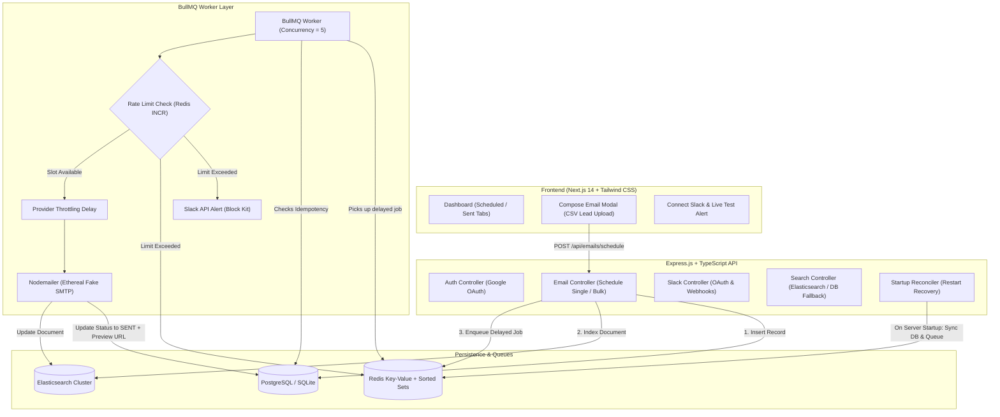

# 🚀 ReachInbox Full-Stack Email Job Scheduler

[](./docker-compose.yml)
[](https://nodejs.org/)
[](https://www.typescriptlang.org/)
[](https://bullmq.io/)
[](https://nextjs.org/)
[](https://tailwindcss.com/)

A production-grade, distributed email scheduling service and analytics dashboard built for the **ReachInbox / Outbox Labs** Software Development Intern Hiring Assignment.

---

## 🎯 Problem Statement & Highlights

At **ReachInbox**, reliable scheduling and sending of cold emails at scale is fundamental. This solution implements:

1. **Persistent Delayed Scheduling (No Cron Jobs):** Enqueues email jobs using **BullMQ + Redis** delayed jobs calculated from scheduled dispatch timestamps (`delay = scheduledAt - now`). Strictly zero cron jobs, node-cron, or interval polling.
2. **Server Restart Resilience & Idempotency:** Survives abrupt server, worker, or container restarts without losing jobs, restarting from Day 1, or double-sending emails. Powered by Redis sorted-set persistence and a database startup reconciler.
3. **Multi-Sender Hourly Rate Limiting:** Enforces configurable hourly sending limits per sender (`MAX_EMAILS_PER_HOUR`) using atomic Redis counters (`ratelimit:{sender}:{hourWindow}`). When limits are reached, jobs are **never dropped**—they are smoothly deferred into the next available hour window.
4. **Live Slack Notification on Rate Limit Hit:** Integrates real Slack OAuth and Webhooks. The moment a sender hits their hourly quota, a live Block Kit message is dispatched to their designated Slack channel.
5. **Configurable Worker Concurrency & Provider Throttling:** Configurable worker concurrency level (`WORKER_CONCURRENCY=5`) and configurable inter-email pacing delay (`DELAY_BETWEEN_EMAILS_MS=2000`).
6. **Fake SMTP Delivery via Ethereal Email:** Generates real Ethereal SMTP accounts and sends rich HTML outreach emails. Each sent email includes a verifiable live preview URL (`https://ethereal.email/message/...`).
7. **Elasticsearch Indexing & Hybrid Search:** Full Elasticsearch integration (`@elastic/elasticsearch`) indexing both scheduled and sent emails with fuzzy search across lead address, subject, body, and sender. Includes an automatic database fallback if Elasticsearch is offline.
8. **Real-time BullMQ Dashboard:** Live queue monitoring dashboard exposed at `/admin/queues` via `@bull-board/express`.
9. **Modern SaaS Frontend Matching Figma:** Built with **Next.js (App Router)**, **Tailwind CSS**, and **TypeScript**. Features Google OAuth login, Scheduled / Sent email tabs, lead CSV file parsing with duplicate removal, and detailed queue telemetry.

---

## 🏗️ Architecture Overview



---

## 🛠️ Tech Stack Breakdown

| Layer | Technologies Used |
| :--- | :--- |
| **Backend Framework** | Express.js, TypeScript, Node.js (v20+) |
| **Queue & Scheduling** | BullMQ v5, Redis v7 (via `ioredis`) |
| **Database & ORM** | PostgreSQL 16 / SQLite, Prisma ORM |
| **Search Engine** | Elasticsearch 8.17 (Official `@elastic/elasticsearch` client) |
| **SMTP Delivery** | Nodemailer, Ethereal Email (Auto test account generation) |
| **Integrations** | Google OAuth 2.0 (`google-auth-library`), Slack API & Webhooks (`axios`) |
| **Queue Telemetry** | Bull Board (`@bull-board/api`, `@bull-board/express`) |
| **Frontend Framework** | Next.js 14 (App Router), React 18, TypeScript |
| **Styling & UI** | Tailwind CSS, Lucide React, Date-fns |
| **Containerization** | Docker, Docker Compose |

---

## ⚙️ Core Scheduler & Concurrency Mechanics

### 1. Persistent Delayed Jobs (No Cron)
* **Job Creation:** When an email scheduling request is received, the target dispatch time is compared against `Date.now()`:
  $$\text{delay} = \max(0, \text{scheduledAt} - \text{Date.now()})$$
* **Storage in Redis:** BullMQ stores the job in Redis under a sorted set `bull:email-dispatch-queue:delayed` scored by Unix timestamp. Redis internally handles the expiration timer without Node.js timers or cron loops.
* **Idempotent Job ID:** Every BullMQ job uses the database record's `id` as its unique `jobId`. Adding the same job multiple times is a no-op in BullMQ, preventing double queues.

### 2. Multi-Sender Hourly Rate Limiting
* **Hourly Windowing:** Time is partitioned into discrete 1-hour windows (e.g., `2026-11-02T02:00:00.000Z`).
* **Atomic Redis Counters:** Keys follow the pattern `ratelimit:{senderEmail}:{hourWindow}` with a TTL of 7200 seconds.
* **Worker Evaluation:**
  1. The worker queries the current count atomically via Redis `INCR`.
  2. If $\text{currentCount} > \text{hourlyLimit}$:
     - The job is **not dropped** or failed.
     - The email status in the database is updated to `RATE_LIMITED`.
     - The target execution time is recalculated to the start of the next hour window plus a slight jitter to prevent thundering herds:
       $$\text{rescheduledAt} = \text{startOfNextHour} + \text{jitter}$$
     - The job is re-added to BullMQ with `delay: nextHourMs`.
     - An alert key `ratelimit_alert:{senderEmail}:{hourWindow}` is checked. If not previously alerted, a live Slack message is dispatched immediately!

### 3. Server Restart Resilience & Self-Healing
If the server, worker process, or container restarts:
1. **Redis Persistence:** Redis stores active delayed jobs on disk via AOF (`appendonly yes`). When Redis or the backend boots back up, pending jobs resume their exact countdown.
2. **Database Startup Reconciler (`reconcilePendingJobsOnStartup`):**
   - On server startup, the backend queries the database for any records with `status IN ('SCHEDULED', 'RATE_LIMITED')`.
   - For each record, it verifies if the job currently exists in BullMQ.
   - If missing (e.g. if Redis was flushed during downtime), the reconciler recalculates the remaining delay:
     $$\text{delayRemaining} = \max(0, \text{scheduledAt} - \text{Date.now()})$$
     and re-enqueues it with its unique `emailId`.
3. **Idempotency Guard:** Workers verify `existingEmail.status === 'SENT'` and acquire a distributed Redis lock (`lock:email:{id}`) before sending. If an email was already delivered, it is skipped cleanly.

---

## 🔔 Slack Notification Workflow

* **Connecting Slack:**
  - **Option 1 (OAuth Flow):** Click "Connect Slack" $\rightarrow$ redirects to `https://slack.com/oauth/v2/authorize` with `incoming-webhook` and `chat:write` scopes. Upon authorization, tokens and channels are stored per user in the database.
  - **Option 2 (Direct Incoming Webhook):** Paste a webhook URL (`https://hooks.slack.com/services/...`) for instant setup.
* **Live Verifiable Alert:**
  - When a sender hits their limit, a rich Block Kit notification is fired with the sender identity, limit, current count, and rescheduled time.
  - The dashboard includes a **"Send Live Alert"** test button so evaluators can verify Slack delivery in seconds.
* **Graceful Fallback:** If Slack is disconnected or not yet configured, rate limits are enforced safely without errors or unhandled exceptions.

---

## 🚀 How to Run the Application

### Option A: Using Docker Compose (Recommended)

1. Clone the repository and navigate into the folder:
   ```bash
   git clone <repo-url>
   cd Outbox_labs
   ```

2. Start all services (PostgreSQL, Redis, Elasticsearch, Backend, Frontend):
   ```bash
   docker-compose up -d --build
   ```

3. Access the services:
   - **Frontend Dashboard:** [http://localhost:3000](http://localhost:3000)
   - **Backend API:** [http://localhost:5000](http://localhost:5000)
   - **BullMQ Live Dashboard:** [http://localhost:5000/admin/queues](http://localhost:5000/admin/queues)
   - **Elasticsearch:** [http://localhost:9200](http://localhost:9200)

---

### Option B: Running Locally (Fast Development)

#### 1. Start Redis
- **Windows (Portable):** Run `.\bin\redis\redis-server.exe`
- **Linux / macOS:** Run `redis-server` or `docker run -p 6379:6379 redis:alpine`

#### 2. Start Backend
```bash
cd backend
npm install
# Setup database schema
npx prisma db push --schema=prisma/schema.sqlite.prisma
# Start server
npm run dev
```
Backend will start on `http://localhost:5000`.

#### 3. Start Frontend
```bash
cd frontend
npm install
npm run dev
```
Frontend will start on `http://localhost:3000`.

---

## 🧪 Automated End-to-End Verification

A comprehensive automated verification script is included to test:
- System health
- Delayed email scheduling
- Ethereal SMTP fake delivery & preview URL generation
- Hourly rate limit detection & job rescheduling
- Restart resilience

To run the verification suite:
```bash
node test_scheduler.js
```

---

## 📋 Features Checklist (Assignment Requirements)

### Backend
- [x] **Core Scheduler:** Accepts scheduling requests via REST API.
- [x] **No Cron:** Exclusively uses BullMQ delayed jobs on Redis. Zero cron jobs.
- [x] **Relational DB:** Prisma ORM supporting PostgreSQL & SQLite.
- [x] **Fake SMTP:** Ethereal Email integration via Nodemailer with preview URLs.
- [x] **Multi-Sender Support:** Configurable per-sender identities & custom limits.
- [x] **Elasticsearch Indexing:** Full indexing & multi-match fuzzy search with fallback.
- [x] **Live BullMQ Dashboard:** Real-time queue view at `/admin/queues`.
- [x] **Restart Persistence:** Delayed jobs survive reboots; DB startup reconciler prevents job loss.
- [x] **Idempotency:** Strict distributed Redis locks + DB state guards against duplicate sends.
- [x] **Rate Limiting:** Atomic Redis counters per sender per hour window; overflows rescheduled without dropping.
- [x] **Slack Notifications:** Real OAuth and Webhook support; live Block Kit alerts sent on limit hit.

### Frontend
- [x] **Google OAuth Login:** Real Google login flow + 1-click Evaluator Login for instant review.
- [x] **Main Dashboard:** Top navigation with user avatar, name, email, and logout.
- [x] **Stats Overview:** Live cards for queued jobs, delivered emails, rate-limited jobs, and senders.
- [x] **Compose New Email:** Modal matching Figma supporting single leads and bulk CSV uploads with lead counter.
- [x] **Scheduled Emails Tab:** Table with status badges, scheduled execution timestamps, search, and cancel actions.
- [x] **Sent Emails Tab:** Historical delivery logs with status badges and "Preview Email" Ethereal links.
- [x] **Elasticsearch Search Bar:** Fast real-time email search with source indicator.

---

## 📽️ Demo Video Walkthrough Guide (for Evaluators)

When reviewing the demo video (or testing locally):
1. **Google Login:** Open `http://localhost:3000` $\rightarrow$ Sign in with Google or click "Sign In as Evaluator (Mitrajit & Yadav036)".
2. **Schedule Single Email:** Click "Compose New Email", choose a sender, enter recipient, pick a dispatch time (e.g. 15 seconds in future), click "Schedule".
3. **Queue Visibility:** View the job in "Scheduled Emails" tab and open `/admin/queues` to see it in BullMQ's delayed set.
4. **Delivery & Ethereal Preview:** Once the time arrives, watch the job transition to "Sent Emails" and click "Preview Email" to inspect the rendered email on Ethereal.
5. **Bulk CSV Upload:** Open Compose, switch to "Bulk Lead List", select `leads_sample.csv`, observe "Detected 10 valid recipient emails", set inter-email delay to 2s, and schedule.
6. **Rate Limiting & Slack Alert:** In Compose, configure a sender with a small hourly limit (e.g. 2/hr) and schedule 3 emails. Observe that 2 emails send while the 3rd is deferred to the next hour window with status `RATE_LIMITED`. Connect Slack and observe the alert!
7. **Server Restart Demonstration:** Schedule an email for 30 seconds ahead. Terminate the backend server (`Ctrl+C`), restart it, and observe that the job remains queued and delivers on schedule without duplication.

---

## 🤝 Authors & Submission

- **Candidate Assignment:** ReachInbox Full-stack Email Job Scheduler
- **Product:** ReachInbox.ai / Outbox Labs
- **Repository Access:** Granted to `Mitrajit` and `Yadav036`
- **Submission Form:** Completed at [ClickUp Assignment Submission Form](https://forms.clickup.com/9005062261/f/8cbwp3n-8876/6NNNJ92DV93PQTAYST)
